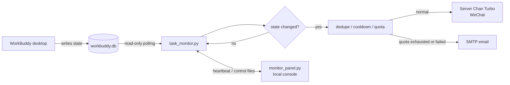

# WorkBuddy Task Monitor

> Get notified the moment a WorkBuddy task finishes, fails, gets stuck, or waits for your confirmation — pushed to WeChat, with automatic email fallback. Ships with a double-click local control panel.

[简体中文](README.md) | **English**


---

## Why

The WorkBuddy desktop app records every session's task state in a local SQLite database. Long-running tasks are easy to forget — by the time you check back, the task may have finished, failed silently, or be blocked on a confirmation dialog that has been waiting for you.

This project is a **zero-dependency, read-only Python watcher**. It polls that database, detects meaningful state changes, and pushes a notification to your phone. It never writes to WorkBuddy's data or configuration.

> Unofficial third-party tool, not affiliated with WorkBuddy. It only reads the local database.

## Features

| Feature | Description |
|---|---|
| ✅ Completion | Notifies when a task transitions to `completed` |
| ⚠️ Failure | Notifies on `terminated` / `failed` / `cancelled` |
| 🙋 Needs your input | Detects new "waiting for confirmation" records and includes the pending content |
| ⏳ Stuck detection | Alerts when a running task has no activity beyond a threshold (default 10 min), with cooldown |
| 📲 Dual channel | Server Chan Turbo → WeChat by default; automatic SMTP email fallback when the daily quota is exhausted or delivery fails |
| 🔇 No spam | State-fingerprint deduplication + cooldown + daily limit |
| 🤖 Process awareness | Idles quietly when WorkBuddy isn't running, resumes instantly when it starts |
| 🖥️ Control panel | Local web console: live status, one-click start/stop monitoring and autostart |
| 🔒 Non-invasive | Read-only DB access (`mode=ro`), single-instance lock |

## How it works



It reads two tables: `sessions` (status, last activity, session title) and `session_turn_interruptions` (pending confirmations). Each round is compared against the previous one; only real changes produce notifications. The display name prefers the title you renamed in the UI.

## Quick start

### Requirements

- Windows 10/11 (the core script is cross-platform; process awareness and autostart are Windows implementations)
- Python 3.8+ — **no third-party packages**
- WorkBuddy desktop app, launched at least once (to create its database)

### Option A — Double-click the panel (easiest)

1. Clone the repo:

   ```bash
   git clone https://github.com/GZXchina/workbuddy-task-monitor.git
   ```

2. Double-click `start_panel.bat` (or `启动面板.bat` on a Chinese system). Your browser opens the local console.
3. Click **Start monitoring**. If no SendKey is configured yet, the panel opens the config file for you.
4. Turn on **Autostart** at the bottom of the panel. Done — it runs at every Windows login.

### Option B — One-command setup (PowerShell)

```powershell
powershell -ExecutionPolicy Bypass -File .\setup.ps1
```

The script checks Python, creates the config, registers a scheduled task (logon trigger + 5-minute self-heal) and starts it. On the first run it opens the config file; fill in `sendkey`, save, then run it once more.

### Option C — Manual

```bash
copy task_monitor_config.example.json task_monitor_config.json
# edit the config and set at least "sendkey"
python task_monitor.py --self-test   # print states + send a test notification
python task_monitor.py --test-email  # test the email channel only
python task_monitor.py               # run as a resident watcher
```

For autostart, create a Task Scheduler task with an "At log on" trigger running `pythonw.exe task_monitor.py`. Adding a 5-minute repeating trigger is recommended as a watchdog — the single-instance lock makes duplicate launches exit immediately.

## Control panel

Double-click `启动面板.bat` (or run `python monitor_panel.py`); it serves `http://127.0.0.1:47832` and refreshes every 2 seconds.

| Area | Content |
|---|---|
| Top status | Running / Idle (WorkBuddy not running) / Paused / Not running, plus PID |
| Cards | WorkBuddy state, monitored task count, today's pushes, last poll, uptime, email fallback readiness |
| Buttons | Start monitoring / Stop monitoring / Poll now / Send test notification |
| Chips | Poll interval, stuck threshold, daily limit, credential status |
| Recent activity | Live log lines, colour-coded |
| Footer | Open config, view log, open folder, autostart toggle, close panel |

Notes:

- **Stop monitoring** pauses polling instead of killing the process, so the watchdog won't restart it; **Start monitoring** resumes within ~2 seconds.
- The **Autostart** toggle adds/removes the Windows scheduled task `WorkBuddyTaskMonitor`.
- The panel binds `127.0.0.1` only and validates the Host header; it exits automatically about 2 minutes after the browser tab closes.
- Implemented with the standard library (`http.server`) only.

## Notifications

- `✅ 完成｜<task>` — completed
- `⚠️ 异常｜<task>` — terminated / failed
- `🙋 待拍板｜<task>` — waiting for your confirmation, with the pending content
- `⏳ 卡住｜<task>` — no progress beyond the threshold

Multiple events in one round are merged into a single message.

## Configuration

`task_monitor_config.json` (copied from the example; excluded by `.gitignore`).

| Key | Type | Description | Default |
|---|---|---|---|
| `sendkey` | string | Server Chan Turbo SendKey (`SCT…`) | empty |
| `db_path` | string | Database path; empty means `~/.workbuddy/workbuddy.db` | empty |
| `poll_seconds` | int | Poll interval in seconds | 60 |
| `stuck_minutes` | int | Idle minutes before "stuck" | 10 |
| `stuck_cooldown_minutes` | int | Cooldown between stuck alerts | 30 |
| `daily_limit` | int | Max WeChat pushes per day | 4 |
| `exclude_titles` | array | Skip tasks whose title contains these keywords | `[]` |
| `exclude_cwd` | array | Skip tasks whose working dir contains these keywords | `[]` |
| `email.enabled` | bool | Enable email fallback | `true` |
| `email.smtp_host` | string | SMTP host | `smtp.qq.com` |
| `email.smtp_port` | int | SMTP port | `465` |
| `email.use_ssl` | bool | SSL (true for 465, false for 587) | `true` |
| `email.smtp_user` | string | Sender address | empty |
| `email.smtp_pass` | string | SMTP auth code (not your login password) | empty |
| `email.mail_to` | string | Recipient address | empty |
| `email.sender_name` | string | Sender display name | 任务监控助手 |

Changes take effect on the next poll — no restart needed.

## Getting credentials

**Server Chan SendKey** — sign in at <https://sct.ftqq.com> with the WeChat account that should receive notifications, follow the "方糖" official account, then copy the `SCT…` key from the SendKey page. The free tier allows 5 messages/day; the default limit of 4 leaves headroom.

**SMTP auth code** — for QQ Mail: Settings → Account → enable IMAP/SMTP, complete verification, copy the 16-character auth code. For 163/Gmail the flow is analogous; adjust `smtp_host` / `smtp_port` / `use_ssl` accordingly.

## Moving to another computer

Scheduled tasks are machine-local, so a new machine needs a one-time setup: install Python 3.8+, copy the folder, double-click `start_panel.bat`, click **Start monitoring**, enable **Autostart**. The target machine must have WorkBuddy installed and launched once. If the database lives elsewhere, set `db_path`.

## FAQ

**The panel says "not running" — is the watcher dead?**
The panel reads a heartbeat file (`monitor_status.json`). Click **Start monitoring** in the panel; if it still fails, check the tail of `monitor.log`.

**Does it spam errors when WorkBuddy is closed?**
No. It checks for `WorkBuddy.exe` each round and idles quietly when absent.

**Why are some tasks not monitored?**
Only non-deleted, running sessions are in scope. Completed tasks notify once, at the transition. Use `exclude_titles` / `exclude_cwd` to exclude more.

**Will it unblock a stuck task?**
No. The tool only observes and notifies — it never touches WorkBuddy's tasks or database.

**Push succeeded in the log but WeChat shows nothing?**
Check the Server Chan dashboard and your WeChat binding; the free tier can be delayed by a few minutes. The email fallback record is in `monitor.log`.

## Known limitations

- Stuck detection is heuristic (long inactivity may be legitimate waiting); the threshold is configurable.
- Confirmation detection depends on WorkBuddy writing rows to `session_turn_interruptions`.
- Task states only update while WorkBuddy is running.
- Table structure is version-coupled; a major WorkBuddy upgrade may require adaptation.
- Nothing runs while the machine sleeps or is powered off.
- Email may land in spam on first delivery — mark it as not spam.
- The panel is local-only by design (no remote access).

## Security & privacy

- Database is opened read-only (`mode=ro`); nothing is written back.
- SendKey and SMTP auth code live only in the local config, which is git-ignored and never logged.
- No data leaves your machine except through your chosen push channel (Server Chan or your own SMTP server); messages contain only task titles and state descriptions.
- The panel binds to loopback and validates the Host header.

## Project layout

```
.
├── task_monitor.py                    # watcher: polling + event detection + push
├── monitor_panel.py                   # local web control panel (stdlib)
├── 启动面板.bat                        # launch panel (Chinese messages)
├── start_panel.bat                    # launch panel (English messages)
├── setup.ps1                          # one-command Windows setup
├── task_monitor_config.example.json   # config template
├── CHANGELOG.md
├── .gitignore
└── LICENSE
```

## License

[MIT](LICENSE)
