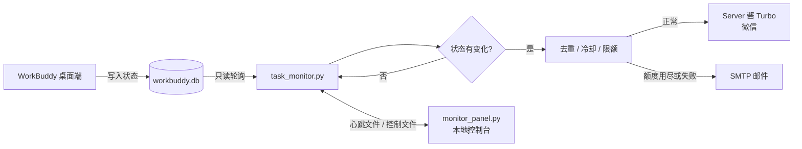

# WorkBuddy Task Monitor · 任务状态主动推送

> 让 WorkBuddy 里跑着的任务自己"报信"：完成、异常、卡住、等你拍板，第一时间推到微信；微信额度用尽自动转邮件。附带一个双击即开的本地控制台。

**简体中文** | [English](README.en.md)


---

## 目录

- [它解决什么问题](#它解决什么问题)
- [功能](#功能)
- [工作原理](#工作原理)
- [快速开始](#快速开始)
- [可视化面板](#可视化面板)
- [通知长什么样](#通知长什么样)
- [配置说明](#配置说明)
- [获取推送凭据](#获取推送凭据)
- [在另一台电脑上使用](#在另一台电脑上使用)
- [常见问题](#常见问题)
- [已知限制](#已知限制)
- [安全与隐私](#安全与隐私)
- [目录结构](#目录结构)
- [更新日志](#更新日志)
- [许可](#许可)

---

## 它解决什么问题

WorkBuddy 桌面端在本地 SQLite 数据库里记录每个会话任务的状态。长任务跑起来之后，人往往就去干别的了——等你想起来看，任务可能早就结束、中途报错，或者卡在某个"是否继续 / 授权确认"的弹窗上等你半天。

本项目是一个**零第三方依赖的常驻 Python 小程序**，用**只读**方式轮询这份数据库，把"值得你知道的变化"推到你手机上，不需要你盯着屏幕，也不改动 WorkBuddy 的任何数据与配置。

> 本项目为第三方开源工具，与 WorkBuddy 官方无关；仅读取本机数据库，不做任何写入。

## 功能

| 能力 | 说明 |
|---|---|
| ✅ 完成通知 | 任务由运行中变为 `completed` 时推送 |
| ⚠️ 异常终止 | 变为 `terminated` / `failed` / `cancelled` 时推送 |
| 🙋 等待拍板 | 检测到新的"等待用户确认/授权"记录时推送，并附带待确认内容 |
| ⏳ 疑似卡住 | 任务仍在运行但超过阈值（默认 10 分钟）无活动时提醒，带冷却 |
| 📲 双通道 | 主通道 Server 酱 Turbo → 微信；额度用尽或推送失败自动降级 SMTP 邮件 |
| 🔇 防轰炸 | 状态指纹去重 + 卡住冷却 + 每日限额，只在真正变化时发 |
| 🤖 进程感知 | WorkBuddy 没开时静默待机（不读库、不刷错误日志），一开立即恢复巡检 |
| 🖥️ 可视化面板 | 本地网页控制台：自动检测运行状态、实时展示、一键开关监控与开机自启 |
| 🔒 零侵入 | 数据库以 `mode=ro` 只读打开；单实例锁避免重复运行 |

## 工作原理



- **数据来源**：`sessions`（任务状态、最后活动时间、会话名）与 `session_turn_interruptions`（等待确认记录）两张表。
- **判定方式**：每轮把当前状态与上一轮比对，只有"变化"才产生事件；会话名优先取用户在界面上自定义的标题。
- **解耦设计**：监控主程序不依赖面板，面板只是读写两个本地 JSON（心跳与控制），两者可独立运行。

## 快速开始

### 环境要求

- Windows 10/11（核心脚本跨平台，自动跟随 WorkBuddy 进程与开机自启为 Windows 实现）
- Python 3.8+（**不需要安装任何第三方包**）
- WorkBuddy 桌面端，且至少启动过一次（用于生成状态数据库）

### 方式一：双击面板（推荐，最简单）

1. 下载或克隆本项目到本地任意目录：

   ```bash
   git clone https://github.com/GZXchina/workbuddy-task-monitor.git
   ```

2. 双击 **`启动面板.bat`**（非中文系统可用 `start_panel.bat`），浏览器会自动打开本地控制台。
3. 面板会提示配置状态。点「开启监控」时若还没填 SendKey，会自动打开配置文件，填好保存即可。
4. 在面板底部把「**开机自启**」打开 —— 部署完成，之后登录 Windows 就会自动运行。

### 方式二：命令行一键部署

```powershell
powershell -ExecutionPolicy Bypass -File .\setup.ps1
```

脚本会检查 Python 环境、生成配置文件、注册计划任务（登录自启 + 每 5 分钟自愈）并启动。首次运行会打开配置文件，填好 `sendkey` 后**再运行一次**即可。

### 方式三：完全手动

```bash
# 1. 复制配置
copy task_monitor_config.example.json task_monitor_config.json

# 2. 编辑配置，至少填写 sendkey（邮件兜底见下文）
# 3. 自检：打印任务状态并发送测试通知
python task_monitor.py --self-test

# 4. 仅测试邮件通道
python task_monitor.py --test-email

# 5. 常驻运行
python task_monitor.py
```

开机自启可用「任务计划程序」建一个「登录时」触发的任务，操作指向 `pythonw.exe`，参数为 `task_monitor.py` 的完整路径。建议再加一条「每 5 分钟重复」的触发器作自愈守护——程序有单实例锁，已在运行会立即退出，不会重复启动。

## 可视化面板

双击 `启动面板.bat`，浏览器打开 `http://127.0.0.1:47832`；也可直接运行 `python monitor_panel.py`。

打开即自动检测后台监控是否在运行，并每 2 秒刷新：

| 区域 | 内容 |
|---|---|
| 顶部状态 | 运行中 / 待机中（WorkBuddy 未开）/ 已暂停 / 未运行，附进程 PID |
| 状态卡片 | WorkBuddy 是否在跑、已监控任务数、今日推送量、最后巡检时间、运行时长、邮件兜底是否就绪 |
| 主按钮 | **开启监控** / **关闭监控** / 立即巡检 / 发送测试通知 |
| 参数标签 | 巡检间隔、卡住阈值、每日上限、SendKey 与邮件配置状态 |
| 最近动态 | 实时日志，成功 / 失败 / 暂停按颜色区分 |
| 底部 | 打开配置文件、查看日志、打开目录、开机自启开关、关闭面板 |

几个关键行为：

- **「关闭监控」不是杀进程**，而是让后台程序暂停巡检（写入控制文件），因此不会被自愈触发器重新拉起；点「开启监控」约 2 秒内恢复，并立即重扫一轮。
- **「开机自启」开关**直接增删 Windows 计划任务 `WorkBuddyTaskMonitor`，不用再碰脚本。
- 面板仅监听 `127.0.0.1` 并校验 Host 头，只有本机可访问；关闭浏览器标签页后约 2 分钟面板服务自动退出，不留后台进程。
- 全部用 Python 标准库（`http.server`）实现，不需要 Flask 之类的框架。

## 通知长什么样

微信（Server 酱）与邮件正文格式一致：

- `✅ 完成｜某任务` — 任务已完成
- `⚠️ 异常｜某任务` — 任务异常终止
- `🙋 待拍板｜某任务` — 任务在等你确认，正文附带待确认内容
- `⏳ 卡住｜某任务` — 超过阈值无进展

多条事件会合并成一条消息，避免刷屏。

## 配置说明

配置文件 `task_monitor_config.json`（由示例文件复制而来，已被 `.gitignore` 排除，不会提交）。

| 字段 | 类型 | 说明 | 默认 |
|---|---|---|---|
| `sendkey` | string | Server 酱 Turbo 的 SendKey，`SCT` 开头 | 空 |
| `db_path` | string | 数据库路径；留空则用 `~/.workbuddy/workbuddy.db` | 空 |
| `poll_seconds` | int | 巡检间隔（秒） | 60 |
| `stuck_minutes` | int | 多少分钟无活动判定为疑似卡住 | 10 |
| `stuck_cooldown_minutes` | int | 卡住提醒冷却时间（分钟） | 30 |
| `daily_limit` | int | 每日微信推送条数上限 | 4 |
| `exclude_titles` | array | 按标题关键词排除任务 | `[]` |
| `exclude_cwd` | array | 按工作目录关键词排除任务 | `[]` |
| `email.enabled` | bool | 是否启用邮件兜底 | `true` |
| `email.smtp_host` | string | SMTP 服务器 | `smtp.qq.com` |
| `email.smtp_port` | int | SMTP 端口 | `465` |
| `email.use_ssl` | bool | 是否 SSL（465 用 true，587 用 false） | `true` |
| `email.smtp_user` | string | 发件邮箱 | 空 |
| `email.smtp_pass` | string | SMTP 授权码（不是登录密码） | 空 |
| `email.mail_to` | string | 收件邮箱 | 空 |
| `email.sender_name` | string | 发件人显示名 | 任务监控助手 |

> 改完配置无需重启：下一轮巡检自动读取生效（`sendkey`、阈值、排除项均如此）。

## 获取推送凭据

### Server 酱 SendKey（微信通道）

1. 打开 <https://sct.ftqq.com>，用**接收通知的那个微信**扫码登录。
2. 关注「方糖」公众号并完成绑定。
3. 在「SendKey」页面复制以 `SCT` 开头的密钥，填入配置。

免费版每天 5 条，程序默认上限 4 条留余量；不够可升级会员或改用 Server 酱³。

### 邮箱 SMTP 授权码（兜底通道）

1. 登录 QQ 邮箱网页版 → 设置 → 账户。
2. 开启「IMAP/SMTP 服务」，完成短信验证。
3. 复制 16 位授权码，填入 `email.smtp_pass`。

163、Gmail 等邮箱同理：开启 SMTP 服务后生成授权码，并相应修改 `smtp_host` / `smtp_port` / `use_ssl`。

## 在另一台电脑上使用

计划任务是**绑定到具体电脑**的系统配置，不会跟着代码走，所以新电脑需要部署一次。现在只需要：

1. 装 Python 3.8+（安装时勾选 **Add Python to PATH**），无需第三方包。
2. 复制整个项目文件夹过去（或 `git clone`）。
3. 双击 `启动面板.bat`，点「开启监控」，再打开「开机自启」。

前提有两条：新电脑装有 WorkBuddy 桌面端且启动过一次；若数据库不在默认位置（`用户目录\.workbuddy\workbuddy.db`），在配置里填 `db_path`。

多台电脑可以共用一个 SendKey，也可以在 Server 酱后台分别建多个。免费额度按账号计，多机同时用会更快耗尽，此时邮件兜底会自动接上。

## 常见问题

**Q：程序显示"未运行"，但我觉得它应该在跑？**
面板读的是心跳文件 `monitor_status.json`，心跳超过 2 分钟未更新即判定为未运行。双击 `启动面板.bat` 后点「开启监控」即可拉起；若仍不行，查看 `monitor.log` 最后几行。

**Q：WorkBuddy 关了，会不会一直报错？**
不会。程序每轮先检测 `WorkBuddy.exe`，未运行时进入低耗待机（每 30 秒轻量探测，不读库、不写错误日志），检测到启动后自动恢复巡检。

**Q：为什么有些任务没被监控？**
未删除且状态为运行中的任务才会进入监控范围。已完成的任务只在"状态发生变化的瞬间"通知一次，之后不再重复。也可以用 `exclude_titles` / `exclude_cwd` 主动排除。

**Q：任务卡住了，程序会不会自动处理？**
不会。程序只做观察与通知，不干预 WorkBuddy 的任何任务，也不会修改数据库。

**Q：微信没收到，但日志显示推送成功？**
先看 Server 酱后台的调用记录；再确认微信是否绑定成功。免费版偶有延迟，几分钟内到达属正常。邮件兜底是否生效可看 `monitor.log` 里的降级记录。

**Q：推送太频繁 / 太少？**
调 `daily_limit`（每日上限）、`stuck_minutes`（卡住阈值）、`stuck_cooldown_minutes`（冷却）即可，下一轮生效。

## 已知限制

- **卡住判定是启发式**：依据"长时间无活动时间更新"，本身就在长时间等待外部响应的任务也可能被提醒，可调高阈值。
- **待确认识别有前提**：依赖 WorkBuddy 是否把等待确认记录写入 `session_turn_interruptions` 表；不写就无从感知。
- **依赖 WorkBuddy 运行**：任务状态由 WorkBuddy 写入数据库，它不运行时没有新状态可检测。
- **数据库结构耦合**：读取 `sessions` 与 `session_turn_interruptions` 两张表，若 WorkBuddy 大版本升级改了表结构，可能需要适配。
- **休眠/关机期间不工作**：电脑睡眠或关机时程序停止，恢复后按当时状态重新判定。
- **邮件可能进垃圾箱**：首次收到后请标记为「非垃圾邮件」。
- **面板仅本机可用**：只监听 `127.0.0.1`，不提供远程访问（有意如此，避免暴露控制接口）。

## 安全与隐私

- **只读数据库**：以 `mode=ro` 打开，不对 WorkBuddy 数据做任何写入。
- **凭据只存本地**：SendKey 与 SMTP 授权码仅保存在本机 `task_monitor_config.json`，该文件已被 `.gitignore` 排除，不会进入版本库，也不会写入日志。
- **不外传数据**：除推送通道（Server 酱 / 你的 SMTP 服务器）外，程序不向任何第三方发送数据；通知正文仅包含任务名与状态描述。
- **面板无公网暴露**：仅绑定回环地址并校验 Host 头。

## 目录结构

```
.
├── task_monitor.py                    # 主程序：只读轮询 + 事件判定 + 双通道推送
├── monitor_panel.py                   # 可视化面板：本地网页控制台（标准库实现）
├── 启动面板.bat                        # 双击打开面板（中文提示）
├── start_panel.bat                    # 同上，英文提示，适合非中文系统
├── setup.ps1                          # Windows 命令行一键部署（环境检查/生成配置/注册自启）
├── task_monitor_config.example.json   # 配置示例（复制为 task_monitor_config.json 后填写）
├── CHANGELOG.md                       # 更新日志
├── .gitignore                         # 排除敏感配置与运行时产物
├── LICENSE                            # MIT
└── 运行时生成（不提交）
    ├── task_monitor_config.json       # 实际配置（含密钥，绝不提交）
    ├── task-monitor-state.json        # 任务状态快照（去重依据）
    ├── monitor_status.json            # 心跳与实时状态（面板读取）
    ├── monitor_control.json           # 面板下发的暂停 / 立即巡检指令
    └── monitor.log                    # 运行日志
```

## 更新日志

见 [CHANGELOG.md](CHANGELOG.md)。

## 许可

[MIT License](LICENSE)
